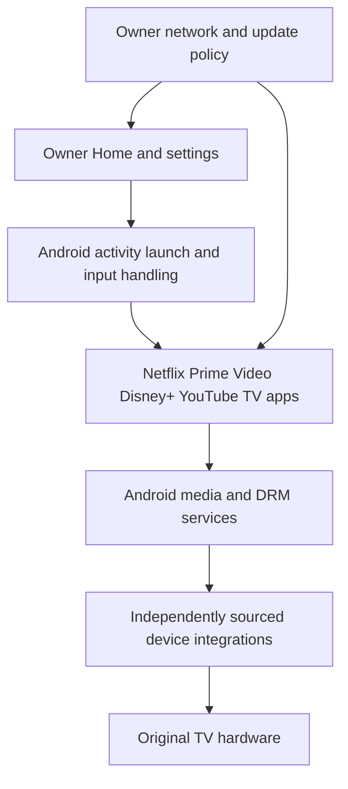

# Sovereign TV

An owner-controlled TV experience and an Android-first replacement project for the original Samsung The Frame LS03F hardware, fully editable through the household's agentOS agent.

**Status: early implementation.** The local experience store/API and browser studio run on a development host. A native Kotlin/Compose TV shell previews and applies the same format with persistent undo; its local build, two JVM unit tests, native Android TV emulator runtime tests and lint pass. Independent Android boot on the Samsung board, production agentOS connectivity, and qualifying provider playback are not demonstrated.

**Current priority: decisive feasibility investigation.** The [exact-board feasibility verdict and experiments](research/FEASIBILITY.md) make boot ownership, complete Samsung-component replacement, recovery and legitimate provider-quality playback prerequisites to the board port. New source analysis traces controller and secure-world dependencies; it does not establish their replaceability. Additional Home features are deferred while these gates remain unresolved.

## Run the first slice

```sh
python3 -m sovereign_tv.server
```

Open `http://127.0.0.1:8765`, read `.local/development-token` locally, and paste it into the studio. Edit the experience JSON, preview, apply, undo, or export for the Android prototype. No dependencies beyond Python 3.9+ are needed. The service stays on loopback and has no TV or provider-account privileges.

```sh
python3 -m unittest discover -s tests -v
python3 tools/check_public.py
```

See [the API](docs/API.md), [native Android shell build/install](android/README.md), [deployment on the actual TV](docs/deployment/PLAN.md), and [agentOS interaction design](docs/agentos-integration.md). CI tests the reference implementation and builds/lints a development APK. The native shell has passed local build/test/lint and runtime tests on ARM64 and CI x86_64 TV emulators; [validation evidence](docs/VALIDATION.md) distinguishes these from actual-TV qualification.

The implemented format currently covers title, themes, row/grid sections, app/collection references, visibility, text scale, and an artwork interval setting. Artwork rendering, profile enforcement, broader widgets/settings, the paired TV service, and agentOS executor are planned. The APK and host studio exchange files manually in this slice.

## Target architecture and requirements

Pursue an owner-maintained Android TV system on the original Samsung 50-inch LS03F hardware. Compose existing open-source components with a custom local home interface and native Netflix, Prime Video, Disney+, and YouTube TV applications. Preserve the quality available through the current TV, including 4K and HDR when supported by the content and subscription.

Android is the selected investigation path. Booting Android and obtaining full-quality playback on this exact board remain to be demonstrated. The original requirement to replace Samsung platform software remains in force; open-source reuse is explicitly allowed. A newly built Android userspace running over retained Samsung boot, kernel, secure-world, or controller software is a research prototype.

## Product architecture

Use AOSP with television features, a custom Home application, local settings and artwork, and the minimum platform integrations required by the native provider TV applications. Google TV branding, its recommendation home screen, and a cloud account for the owner's interface are not product requirements. Access to approved provider clients, DRM provisioning, and any mandatory Google components must be established for the actual product configuration.



The diagram describes intended software boundaries; it does not establish hardware support.

The Home application uses Kotlin and Compose for TV, with D-pad navigation, sofa-readable typography, a stable Home action, owner-defined tile order, and local artwork. Launch installed TV activities through Android's activity interfaces. Discover actual installed applications rather than treating guessed package names as verified integrations. Home does not collect provider passwords or scrape provider viewing history. The paired local control service is required from the first product implementation; a web editor can use the same domain operations without becoming the media player.

Keep configuration in versioned app-private storage with explicit import, export, reset, and migrations. Keep artwork local. The initial Home application should need no network permission. The agentOS control endpoint and any LAN editor run separately with authenticated pairing and narrowly validated changes; LAN membership alone does not authorize control.

Use Android framework and device interfaces for volume, inputs, display, remote, standby, sensors, and artwork power behavior. Implement only the missing board-specific functions. Configuration cannot execute shell commands. Privileged hardware operations stay outside the launcher and provider processes.

## Original remote and responsiveness

Use the existing Samsung remote for ordinary operation, including pairing, navigation, volume, playback, artwork and power/wake gestures supported by the current setup. Manual use must work without agentOS or internet. Preserve focus and screen state across returns, keep local navigation ready, and minimize input and app-switch latency without sacrificing media quality or hardware safety.

The [remote integration and performance plan](docs/REMOTE_AND_PERFORMANCE.md) sets stock-parity acceptance, provisional latency goals, memory/lifecycle rules and target measurements. Original remote compatibility and actual-TV speed remain unverified.

## agentOS integration

Full interaction through [agentOS](https://github.com/ghbmrk/agentOS) is a release requirement. Every owner-built Home, settings, artwork, and administration function must have a typed local operation and observable state. Provider applications must support qualified launch, navigation, title selection, and playback workflows for all four required services. Read state, act, and verify the result through the broker; remote key presses alone do not meet the requirement.

The household agent can author layouts, navigation, themes and widgets; curate displayed content and sources; manage available apps and collections; and change artwork, schedules, and TV settings. Use a versioned local experience document with preview, atomic application, persistence, and undo. Owner-delegated standing grants enable routine edits without repeated approvals. Enforced household access restrictions are separate from hiding content on Home.

Use an agentOS device executor connected to a paired TV control service. The guest reaches broker tools, and the executor alone reaches the pinned TV endpoint. Keep provider playback native and give the control service no access to DRM keys or protected video frames. The TV remains usable by physical remote when agentOS is unavailable. The [integration design and acceptance cases](docs/agentos-integration.md) define the boundary, operation coverage, provider testing, and outstanding agentOS dependencies.

## Media integration

Use the providers' TV applications as the first playback route. Each application owns sign-in, entitlement, session state, and its playback controls. Android's MediaCodec, display composition, and MediaDrm integrations connect them to the hardware. [Android architecture](https://source.android.com/docs/core/architecture) and [DRM integration](https://source.android.com/docs/core/media/drm) describe the relevant framework boundaries.

Build an integration table for decoder, graphics/display composition, audio, DRM plugin, secure execution, secure storage/provisioning, HDMI input, CEC/eARC, and power management. For each entry record the exact hardware, available independent implementation, source or binary provenance, ABI, runtime test, and missing work. Prefer a maintained silicon-vendor Android board-support package when it covers the actual part and meets the component policy. Do not assume such a package exists from a processor marketing name.

Device qualification, client distribution, and new DRM provisioning are dependencies of the playback implementation. Test their availability early. Do not import Samsung provisioning or assume a generic AOSP image inherits the stock TV's service acceptance. Android compatibility, Google service availability, and each provider's UHD/HDR acceptance are separate results.

Measure native source resolution, HDR format and rendering, frame cadence, audio behavior, playback stability, and cold-boot session retention. Compare the same title, plan, settings, and comparable network conditions against stock playback. A 4K display surface or HDR indicator alone does not establish equivalent playback. Image quality also includes tone mapping, color, scaling, and panel behavior.

## Local ownership and network policy

The owner controls Home, settings, artwork, configuration, update policy, and local management. These functions operate without a cloud backend and produce no external traffic during local-only operation. Updates and optional network features have explicit activation and destinations.

Provider applications retain the connectivity necessary for account-based streaming. Record their observed endpoints and distinguish essential playback, optional functions, and inseparable telemetry. Use per-application OS policy integrated with the selected Android release; validate IPv4, IPv6, DNS alternatives, and background activity with external captures. DNS blocking alone is insufficient.

Assess any mandatory Google services by actual app requirements and measured behavior. Replacing a launcher alone does not remove telemetry elsewhere in the system. Do not claim zero provider observation or that application traffic is automatically private because the shell is local.

## Builds and updates

Select the Android branch, kernel, toolchain, and ABI after the board-support investigation. Pin source revisions and binary artifacts. Record licenses, modifications, dependencies, hashes, and reproducibility limits. Proprietary provider or DRM binaries can be independently sourced where the original spec permits them; they remain identified components.

Use a local or owner-managed LAN Linux build host for full AOSP builds. Establish the supported target before allocating a large source checkout. The [AOSP development guide](https://source.android.com/docs/setup/start) specifies substantial workstation resources.

Separate development images from release images. Use release image integrity, controlled debug access, and an owner-maintained update process. [Android Verified Boot](https://source.android.com/docs/security/features/verifiedboot) and [A/B updates](https://source.android.com/docs/core/ota/ab) are candidate mechanisms only where the verified boot/storage design supports them. Ownership of the build does not establish that every modification preserves provider qualification; record and retest that boundary.

Provide recovery independently of Home and network availability. Rollback must account for settings migrations, client state, and compatibility across kernel, vendor integration, and secure-world changes. Local boot health must not depend on a provider or internet service being reachable.

## First implementation milestones

1. Identify the exact model, installed build, board, SoC, ABI, and software stores. Start with normal settings and documented read access. Preserve firmware artifacts off-device and record coverage limits.
2. Match the hardware to independent Android support. Use REA on pinned artifacts for specific boot, initialization, driver, and update questions. Produce the board integration table and establish a practical recovery path before persistent changes.
3. Establish the route to official TV clients and qualifying DRM/protected playback. Prefer a maintained existing integration. Record acquisition and provisioning requirements for this exact product; a subscriber login is not an integration credential.
4. Demonstrate independent Android cold boot, bounded diagnostics, safe power/thermal behavior, input, display, and audio on the TV through a verified testing path.
5. Complete the first real UHD/HDR provider session, then repeat the acceptance sequence for all four services. Verify remote usability and current audio parity.
6. Implement the local Home/settings/artwork product, paired agentOS control and state service, network policy, controlled updates, and recovery. Qualify complete agentOS workflows for each provider and owner-built function. A host/emulator Home prototype may proceed earlier but cannot certify TV or media support.
7. Complete the original Samsung software removal and provenance audit and repeat hardware, media, network, update, and recovery acceptance on the final system.

## Confirmed device and next identification

The owner's About This TV photo confirms model `QN50LS03FAFXZA` and installed software `T-PTMFAKUC-0090-1301.0`. The software version wraps after `-1` in the photo and continues with `301.0`. Serial numbers and other displayed device identifiers are excluded from project records; the raw photo is not copied into the project.

The confirmed family/version matches Samsung's public update metadata for this SKU. Next identify the board, SoC, and ABI through official source artifacts and documented/device-accessible evidence. A family match or a related model cannot establish an Android port, hardware equivalence, or recovery method.

The complete official update archive is now acquired, SHA-256 hashed and CRC-checked. Its metadata identifies version 1301.0, package build date 2026-07-14 and the PontusM 2025 TV family. A bounded parser validates nine outer file ranges; REA 6.5.0/Binwalk 3.1.0 scanned bounded derivations offline. These do not establish authenticated partitions, decrypted payloads, boot policy, recovery or independent Android support. See [firmware and boot findings](research/FIRMWARE_AND_BOOT_FINDINGS.md). The earlier [range record](research/firmware-archive-index.json) remains historical evidence for its original partial reads.

Samsung's source portal lists `25_DTV_PontusM` for model pattern `QN**LS03FA****`. The archive is now acquired offline, hashed and CRC-checked. Bounded inspection found Linux 5.4.261 and an ARMv7/Pontus release configuration with Binder IPC disabled. These are source-family findings, not exact-board or Android-port proof. See [source findings](research/PONTUS_SOURCE_FINDINGS.md) and [community research applicability](research/COMMUNITY_PATHS.md). Exact correspondence between listing version 1000 and installed firmware 1301.0 remains unresolved.

Public findings and their applicability are tracked in [research/sources.json](research/sources.json). Requirements are recorded in [requirements.json](requirements.json), and unobserved target fields stay null in [device-profile.json](device-profile.json). The original owner-supplied specification is retained privately as a local reference and excluded from public distribution.

A [bounded read-only identification tool](docs/READ_ONLY_IDENTIFICATION.md) is ready for the actual TV address. Standard discovery was attempted but failed with host multicast error 65; no TV endpoint, board identity or device-access capability has been observed.
