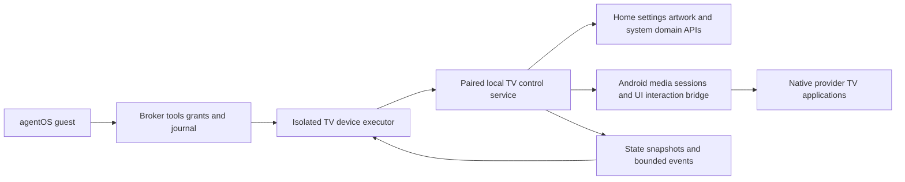

# TV interaction through agentOS

Full interaction through agentOS is a product requirement, alongside native playback quality and local ownership. Build the TV as an observable, controllable local device. Every owner-built function has a typed operation and readable state; each required provider has an independently qualified navigation and playback workflow. This is the implementation design, not a claim that either integration or the Android port already runs.

## Current upstream contract, October 24

The [pinned primary-source review](../research/agentos-current-contract.json) checks agentOS `9806a98dd2b8b85f8f3db1e7e9d7432a1f0bd137`. It supersedes the current-applicability claims of the older journal/lane discussion below; retain that discussion as the existing adapter's historical basis.

The new execution boundary is `kernel.Clerk.Do/Probe`, using a signed `kernel.Request` and `kernel.View`. `clerk.Check` independently checks anchors, the signed plan, live grants, dispatch, hold and clerk-computed facts. The module root preserves the older `journal.Executor`; the new `executor/kernelclerk` implementation uses the current `kernel.Clerk` interface over a broker-independent native protocol package, pinned to the reviewed upstream revision. Its static Linux ARM64 tests and real paired-service apply/retry/reconcile/undo probe pass in the local Android emulator; the [implementation PR](https://github.com/ghbmrk/tv/pull/40) records separate hosted Linux race/vet, Unix-socket and x86_64 emulator checks. Production broker registration and disclosure routing are not supplied by that library. Passing its component tests cannot qualify production integration or justify relabeling its calls as kernel operations.

The new `broker/kernel/key` list **does include** `actuate`, `actuate-physical` and `present`. Their absence from the legacy `broker/verb` list is no longer evidence that current agentOS lacks them. However, `key/verbs.go` classes `Present` as `Reversible`, while the same revision's SPEC DEV-6 says presentation is irreversible and defines audience/disclosure rules. This specific discrepancy is unresolved. Do not resolve it by weakening the TV's authority boundary or substituting an unrelated verb.

Current SPEC DEV-4 treats device configuration as administration, distinct from ordinary actuation; DEV-6/DEV-9 separately govern presentation, audience and vendor visibility. The TV clerk therefore declares configuration as high-class `change-account`, computes private facts locally, and restricts household disclosure to an owner-signed exact plan. Delegated household templates and production disclosure routing remain unimplemented. Receipt integrity alone establishes none of those. The component command shape covers only apply/undo configuration; no provider, hardware-actuation or general presentation operation is declared.

The current lane record reintroduces a limited Codex lane for non-gate documentation/tests; it does not authorize broker writes. No agentOS repository change, issue or message was made. TV-owned work can preserve its transport/domain implementation, but production migration must use the frozen kernel/clerk boundary with its authority semantics resolved. No TV operation or automatic module upgrade follows from this contract review.

## Control architecture

Follow agentOS SPEC ARC-6 and DEV-1–11. Its guest uses broker MCP tools, never a direct TV connection. One isolated device executor holds the TV connection credential and can reach only its pinned endpoint. The TV exposes no shell, ADB, arbitrary URL fetch, arbitrary intent launch, or unrestricted protocol forwarding to agents. The control service has a dedicated OS identity; a small privileged platform bridge exposes only validated operations. The launcher retains no network permission.

Use one domain layer for physical remote, Home UI, local editor, and agent operations. UI state must not be the database. Pairing and grant changes use trusted owner interfaces. The local control endpoint requires authenticated pairing and pinned cryptographic identity; LAN membership is insufficient. A proposed transport is mutually authenticated TLS with versioned JSON requests and a bounded event channel. This is a TV protocol proposal, not an existing agentOS wire contract. Fix its exact schemas only after selecting the Android branch and executor implementation.

## Required operation coverage

| Surface | Required interaction and resulting state |
|---|---|
| Discovery | List supported operations, argument bounds, software/API versions, installed provider activities, and actual feature availability. Use discovered opaque application identifiers. |
| Home | Inspect and edit layouts, navigation, themes, widgets, tiles, collections, and focus behavior; launch, return Home, and restore configuration. |
| Content and availability | Add/remove local content and declared sources; curate displayed rows and collections; show/hide apps and content; apply separately enforceable household/profile availability rules. |
| Artwork | Browse local assets, select artwork, set schedule and bounded brightness, inspect effective mode and schedule. Transfer assets through a declared bounded upload operation. |
| Playback | Inspect available media session, provider, transport state and permitted metadata; play, pause, seek, stop, and change tracks/subtitles where the client exposes these functions. |
| Provider UI | Launch Netflix, Prime Video, Disney+, and YouTube; inspect safe semantic nodes, focus and screen identity; navigate, search, select content, and recover to a known screen. Qualify each workflow per app version. |
| TV system | Read and set supported volume/mute, inputs, picture/audio modes, standby, wake, and owner configuration; report hardware limitations explicitly. |
| Diagnostics | Report versions, health, network policy, measured playback information where exposed, and redacted logs. Do not claim decoded source resolution from display mode alone. |
| Administration | Export/import configuration, stage/verify/activate owner-authorized updates, roll back, and request recovery/reset through typed operations. Destructive actions remain separately authorized. |
| Recovery | Inspect boot health and last update outcome through a minimal service independent of Home. Qualify any recovery-mode control separately from normal Android control. |

Complete interaction means operation coverage, observation, and verified outcomes. Provider sign-in and human verification use a trusted owner handoff; passwords, provisioning material, and protected video are never returned to the agent. Preserve all supported owner-visible functions in the interaction inventory, recording whether each uses a semantic API, qualified UI workflow, or owner handoff. An unimplemented ordinary operation is an acceptance failure, not an implicit handoff.

## Household editing

The household agent can author the TV experience, not only operate the current screen. Owner-delegated standing grants cover routine UI, content, and settings edits without asking for confirmation on every change. Grants identify the household/profile, editable resources, and bounds. Security, pairing, accounts, purchases, and system software retain their corresponding agentOS authority requirements; these do not make ordinary layout edits require repeated approval.

Represent the experience as a versioned local declarative document: screens, navigation, layouts, themes, component instances, content bindings, collections, source references, visibility, household profiles, and schedules. Keep settings typed and queryable through the same domain layer. The agent can create a new page, replace a layout, change what a row contains, add an artwork collection, remove a provider from Home, or set a household evening scene. A scene combines layout/content/settings changes under one validated transaction. Changes persist across reboot and remain editable without agentOS.

Use a maintained component catalog with stable schemas. Support substantial composition and styling rather than a fixed menu of tile reorder operations. New executable widgets or renderer behavior use the owner-controlled build/update pipeline; configuration cannot smuggle scripts, arbitrary network fetches, or platform privileges into the renderer. This keeps the software modifiable while making ordinary customization immediate.

Expose inspect, edit, validate, preview, apply, read-back, and undo operations. An edit names its base revision and scope; validate references, supported settings, focus reachability, and resource bounds before atomic application. Preserve a last-known-good experience and revision history. Undo restores only resources that have not subsequently changed, or returns a conflict for resolution. Preview can be a semantic diff and a local on-TV preview; exporting rendered images still follows capture policy. Keep a physical-remote route to restore the default Home when an otherwise valid layout proves unusable.

Content availability has two distinct meanings. Home visibility and curation govern what is offered on the custom surface. Household restrictions must additionally enforce launch/access policy through the platform where supported; hiding a tile alone does not block deep links, search results, or another launcher. Qualify enforcement against alternate entry paths. Provider catalog entitlements and controls inside Netflix, Prime Video, Disney+, and YouTube remain governed by those applications and accounts. Use supported provider controls where available and identify their limits; do not claim a custom Home filter modifies the provider's internal catalog. Sources and content imported by an agent retain provenance and data labels.

## Android implementation

Use Kotlin domain services for owned software, exposed through authenticated service calls and signature-protected Binder interfaces as appropriate. The implemented [native domain bridge](NATIVE_TRANSACTIONS.md#owner-signed-native-bridge) now provides signature-protected typed experience/asset operations with durable receipts and live Home reconciliation. It runs under the launcher UID in a dedicated process; the [separate-identity paired controller](LOCAL_CONTROL.md) now provides owner-approved mutual TLS for the current editing domain. The production broker route remains unimplemented. Android framework APIs and a narrowly privileged bridge handle media sessions, activity launching, input, power, audio, and display functions. Framework privileges and client compatibility must be verified on the selected build.

Use semantic node IDs, screen revisions, action lists, and focus state for UI control. Provider apps require a qualified accessibility/input bridge where supported; an Android system build does not guarantee a third-party app exposes a useful tree. D-pad fallback must be bounded and followed by observation. Text entry has an explicit destination and length bound; credential fields are owner-only. A navigation action that could purchase, change an account, grant access, or disclose content must enter the corresponding broker operation and authorization path. If its effect cannot be classified from the qualified screen/action mapping, stop at an owner handoff. A generic confirm key cannot bypass effect policy.

Capture is separate from semantic state. Screenshots require agentOS DEV-7 capture authorization and retention/routing enforcement. Protected video surfaces stay protected; no screenshot workaround or DRM-path modification. Semantic state may expose private viewing information and must follow agentOS private-data routing. App text and device events are untrusted data, never instructions or approval signals.

Wake from deep standby is a hardware capability to establish: Android cannot serve requests while unpowered. Use a separately qualified, authenticated standby controller or supported wake path if the hardware permits it. Until demonstrated, report wake as unavailable rather than promising software-only recovery from a dead device.

## Actions and verification

Each proposed request carries a stable request ID, typed operation and bounded arguments, expected state revision, expiry, and control-session identity. The service checks authentication and preconditions immediately before applying it. Persist request deduplication for effects across restarts. A duplicate ID with different arguments is rejected. Relative operations such as seek-forward and D-pad presses must never be blindly replayed after a timeout.

Return accepted, applied, failed, or unknown with a receipt, resulting state revision, and evidence appropriate to the operation. Provide status lookup and reconciliation by the same ID. A transport acknowledgment is not proof of playback, an update, or a setting change. Reconcile uncertain effects from receipts and fresh state; report unconfirmed when the result cannot be established. Never describe an irreversible effect as undone merely because a cancel request was accepted.

Emit bounded, sequenced events for focus/app changes, playback, settings, power, errors, and update health. Reconnect using a cursor; signal gaps and obtain a fresh snapshot. Coalesce floods and preserve foreground responsiveness. The current guest MCP subset has no server-initiated stream; events must enter the broker event bus, not an invented guest SSE connection.

Physical remote interaction takes priority. Cancel or suspend agent navigation when the owner intervenes, invalidate stale screen revisions, and require fresh observation before resuming. Continue ordinary TV use when agentOS or the LAN is absent. Reserve control-service resources so event traffic and observation do not impair UHD/HDR playback.

## agentOS policy and implementation boundary

Operation classes come from the broker's qualified table, not the TV's declared reversibility. Read-only semantic state maps to `read`; video/audio/image responses are capture. Presentation uses `present` and audience policy. Bounded reversible physical settings may qualify as `actuate` only with the required inverse and prior-state evidence. Configuration and firmware use `change-account`; reset/removal use `delete-remote`; adding controllers uses `reveal-or-create-secret`. Purchases retain `buy` authorization. Exact classification belongs in a reviewed TV declaration and broker table, not a permissive remote-control wrapper.

Treat the device as cloud-visible until qualification proves otherwise: provider apps can observe searches, navigation, and viewing activity. Do not send private free text into a provider search merely because its connection passes through the local TV service. Apply DEV-9 disclosure policy and DEV-6 audience policy to content displayed on the household screen.

The TV-owned adapter now pins public agentOS commit `603cad7ce180c7f4f45447b64e652fa4a15d5563` (checked 2026-10-17). The current journal retains the `Execute`/`Reconcile` interface and adds optional key-honouring/lifetime hooks plus parking of unresolved attempts. The TV adapter does not opt into automatic same-key effect retries. Its real file-backed journal tests verify a lost reply, restart fencing, missing-receipt parking without another TV edit, and later settlement from the original receipt. These remain component tests with synthetic policy/redaction, not production grants, guest dispatch, audience enforcement or device qualification. The closed verb list still lacks `present`, `actuate` and `actuate-physical`; exact device policy must be resolved by the broker's owning team.

The TV-owned Go `Inspector` now supplies validated durable-state reads, opaque installed-app discovery and exact-document validation preview over the paired service. It rejects ambiguous field names, digest mismatches, changed targets and contradictory saved/displayed claims. Preview is not presentation or an effect reservation; apply still requires its own policy recheck and native revision check. These private, untrusted documents/catalogs must pass the owning broker's read/disclosure policy and must not enter effect receipts or general logs. No guest read tool or production registration is added by these helpers.

The current upstream [lane record](https://github.com/ghbmrk/agentOS/blob/603cad7ce180c7f4f45447b64e652fa4a15d5563/docs/LANES.md) retires the Codex lane; the earlier hygiene lane is historical, not current authorization. Keep TV service/protocol and adapter work in this repository. Production broker changes need the owning team's reviewed implementation path. No agentOS repository files are modified by this work.

## Release acceptance

1. Exercise every owner-built function through agentOS and compare its resulting state with physical remote operation. Detect missing operations from the function inventory. Create a new layout/page, change displayed collections and available apps, update artwork and settings, preview/apply as one transaction, reboot, and verify persistence. Exercise undo, conflicting edits, invalid configurations, last-known-good recovery, and household scope boundaries. Verify availability restrictions against alternate launch paths, separately from Home visibility. Confirm delegated routine edits do not repeatedly prompt for approval.
2. For each of the four clients, launch, navigate/search, select a title, start/pause/resume/seek where supported, return Home, and reconcile a timeout. Repeat after each supported app upgrade. Verify the same quality baseline with control and observation active.
3. Reject unpaired callers, changed device keys, stale revisions, expired commands, undeclared operations, malformed arguments, and cross-device requests. Confirm broker guests cannot directly reach the TV.
4. Test duplicate requests, lost replies, executor/TV restarts, event gaps, manual interruption, and grant revocation. Never double-apply an uncertain effect.
5. Verify purchases, account changes, disclosure, controller pairing, capture, updates, and resets cannot be reached through a lower-authority navigation operation. Confirm protected frames and synthetic credential canaries are absent from agent output and logs.
6. Test offline Home/artwork/settings, agentOS loss, standby/wake, failed update, and recovery with Home unavailable. Record separately what remains controllable in each power/boot state.

Design references (SPEC/guest links retain the earlier design basis; journal/verb links pin the current component check): [agentOS SPEC](https://github.com/ghbmrk/agentOS/blob/c17b5a92b95c97272c3f138f40a39b28608928b3/SPEC.md), [guest MCP implementation](https://github.com/ghbmrk/agentOS/blob/c17b5a92b95c97272c3f138f40a39b28608928b3/broker/guest/mcp.go), [journal executor contract](https://github.com/ghbmrk/agentOS/blob/603cad7ce180c7f4f45447b64e652fa4a15d5563/broker/journal/intent.go), [closed verb list](https://github.com/ghbmrk/agentOS/blob/603cad7ce180c7f4f45447b64e652fa4a15d5563/broker/verb/verb.go).

## Deliberate movie curation

The [storybook v3 format](STORYBOOK_HOME.md) places the owner-curated movie order, visibility, local poster references and candidate title bindings in the existing preview/apply/undo document. Household edits must be explicitly authorized; providers cannot populate this list. There is no feed, auto-advance or Home autoplay operation. A movie adapter cannot be enabled until exact-title playback and reliable stop-at-end are qualified; selecting a card must never fall back to recommendations. This addition does not lift the production broker lane/policy boundary described above.
